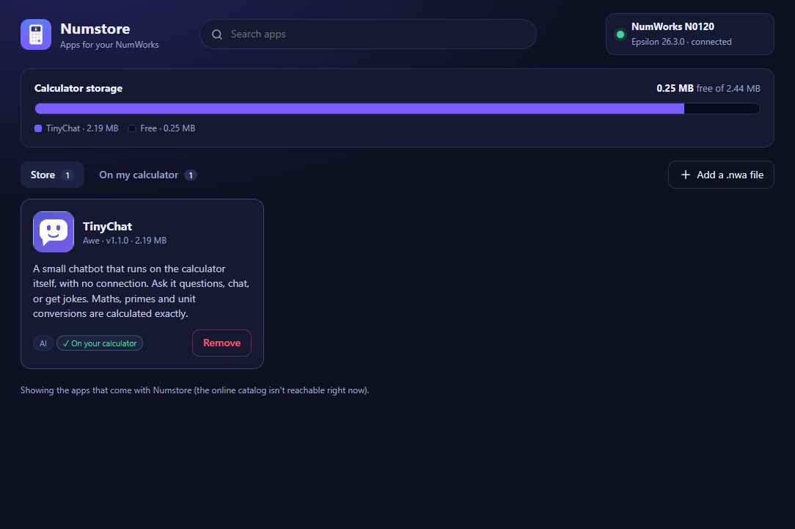

# numstore

Apps for the NumWorks calculator, and **Numstore**, a desktop app to install and remove them.

## Download Numstore

**[Download Numstore for Windows](https://github.com/dev-du-futur/numstore/releases/latest)**: run `Numstore-Setup-x.y.z.exe`.



1. Plug your NumWorks into your computer with a USB cable and turn it on.
2. Numstore shows the calculator, how much space is left, and the apps on it.
3. Click **Install** or **Remove**. The bar shows how much space the change will take before you confirm.

You can also install any `.nwa` app file with **Add a .nwa file**.

Good to know:

- The calculator restarts after each change. Unplug it and plug it back in to see the result.
- Writing apps uses NumWorks' official tool, `nwlink`. Numstore uses your copy if you have one (`npm i -g nwlink`). Otherwise it downloads `nwlink` once from the npm registry.
- An app that wasn't installed with Numstore (or added as a `.nwa` file) is removed by the next change, because the calculator always receives its whole list of apps at once. Numstore warns you before that happens.
- Tested on an N0120 with Epsilon 26.

## Apps

| App | What it does |
|---|---|
| [TinyChat](Apps/Tinychat) | A small chatbot that runs on the calculator itself, without a connection, with built-in maths and unit helpers |

### Adding an app to the store

1. Put the app in `Apps/<Name>/`.
2. Add a `numstore.json` file there, using [TinyChat's](Apps/Tinychat/numstore.json) as the model. It points to the built `.nwa`, an optional data file and a 55×56 PNG icon.
3. Run `npm run catalog` in `Store/`. This updates `catalog.json`. Once it's pushed, Numstore offers the app to everyone without a new release (when the repo is public).

## Building Numstore

You need Node 22 and Python with Pillow (Pillow is only for the icon).

```bash
cd Store
npm install
npm start            # run it
npm run dist         # Windows installer in Store/release/
```

| Path | What it is |
|---|---|
| `Store/src/main.js` | Window, state, install and remove logic |
| `Store/src/device.js` | Reads the calculator over USB (DFU): model, free space, installed apps and their icons. It also erases the apps area when the last app is removed |
| `Store/src/installer.js` | Writes apps with `nwlink install-nwa`, and measures app sizes |
| `Store/src/catalog.js` | Built-in apps, the online `catalog.json`, and apps added from files |
| `Store/src/ui/` | The interface |
| `Store/scripts/` | Catalog builder and icon drawer |
